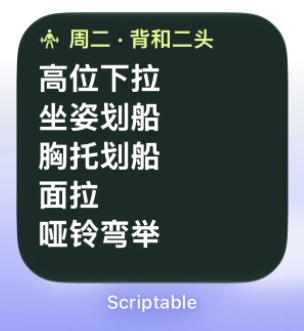

# 今日练什么

点亮 iPhone，就能在锁屏看到今天练哪些动作。主屏幕的小号组件用大字列出动作名称。到了健身房，轻点组件就能查看每个动作做几组、每组做几次、组间休息多久。

## iPhone 主屏幕真机截图

周二的「背和二头」训练在主屏幕上直接列出五个动作。下图截自 iPhone 镜像，保留了小组件所在的主屏幕局部。

## 小号主屏幕组件预览

以下七张截图由浏览器按脚本的小号主屏幕布局渲染，按周一至周日排列。轻点图片可放大查看。

## 在 iPhone 上安装

1. 从 App Store 免费安装并打开一次 [Scriptable](https://apps.apple.com/app/id1405459188)。它负责运行这个小组件，无需开发者账号、自签或开启通知。
2. 用 Safari [下载脚本和配图（ZIP）](https://github.com/RedInn7/DailyMove/archive/refs/heads/main.zip)。在“文件”App 中进入“下载项”，轻点下载的 ZIP 文件解压。
3. 打开解压出来的文件夹，再进入里面的 `Scriptable` 文件夹。把 [今日练什么.js](Scriptable/今日练什么.js) 复制到 **iCloud 云盘 → Scriptable**，让脚本直接放在这个目录下。
4. 如果希望训练详情页显示配图，把整个 [DailyMoveArt 文件夹](Scriptable/DailyMoveArt) 也复制到同一位置，保留文件夹名称。只复制脚本也能查看完整训练计划。
5. 回到 Scriptable，轻点 **今日练什么**。看到今天的动作和组数，就可以把它放到屏幕上了。

## 把组件放到屏幕上

### 主屏幕

长按主屏幕空白处，轻点 **编辑 → 添加小组件**（部分系统显示 **＋**）。搜索 **Scriptable**，选小号方形组件并添加。长按刚添加的组件，选 **编辑小组件**，在 **Script（脚本）** 中选择 **今日练什么**。

### 锁定屏幕

长按已解锁的锁定屏幕，选 **自定 → 锁定屏幕**。轻点时间下方的小组件区域，选择 **Scriptable** 的矩形组件。关闭组件选择面板后，轻点刚放好的矩形，在 **Script（脚本）** 中选择 **今日练什么**，再轻点 **完成**。

组件按 iPhone 当地日期选择训练。脚本会在次日零点请求刷新，实际更新时间由 iOS 决定。[Scriptable 刷新说明](https://docs.scriptable.app/listwidget/#refreshafterdate)

## 一周练什么

| 星期 | 训练 | 时长 |
| --- | --- | --- |
| 周一 | **胸、肩、三头** · 杠铃卧推、上斜哑铃卧推、坐姿哑铃肩推、哑铃侧平举、绳索三头下压 | 60–70 分钟 |
| 周二 | **背、二头** · 高位下拉、坐姿划船、胸托划船、面拉、哑铃弯举。时间紧时，两种划船任选一种 | 60–70 分钟 |
| 周三 | **主动恢复** · 轻松步行 20–30 分钟，再做肩髋活动 5–10 分钟 | 约 25–40 分钟 |
| 周四 | **游泳课** · 跟教练练身体位置、呼吸和自由泳，课后轻松活动 5 分钟 | 按课程时间 |
| 周五 | **私教腿部课** · 重点练杠铃深蹲，其余动作由教练调整。模板含罗马尼亚硬拉、保加利亚分腿蹲、腿弯举、平板支撑 | 约 60 分钟 |
| 周六 | **全身补强** · 传统硬拉、轻重量卧推、坐姿划船、腿举（可选）、悬垂举膝或卷腹。周五训练后腿部酸痛明显时，跳过硬拉和腿举，改练上肢 | 60–70 分钟 |
| 周日 | 完全休息，想活动时可以散步或轻度拉伸 | 全天 |
